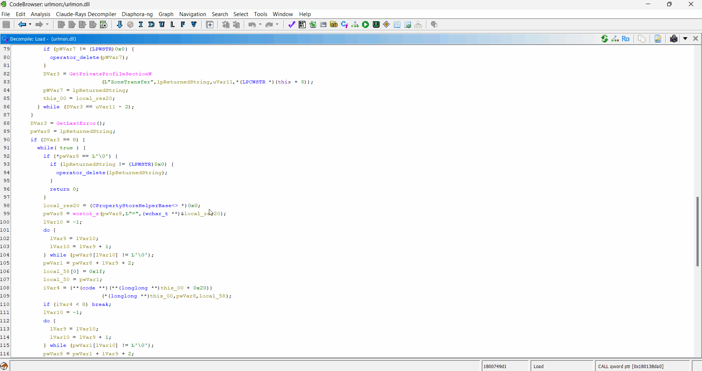
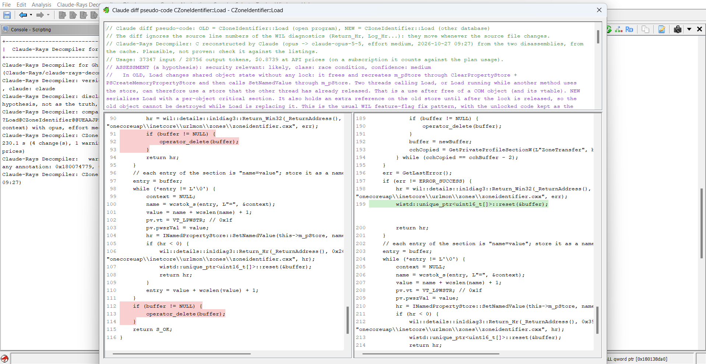
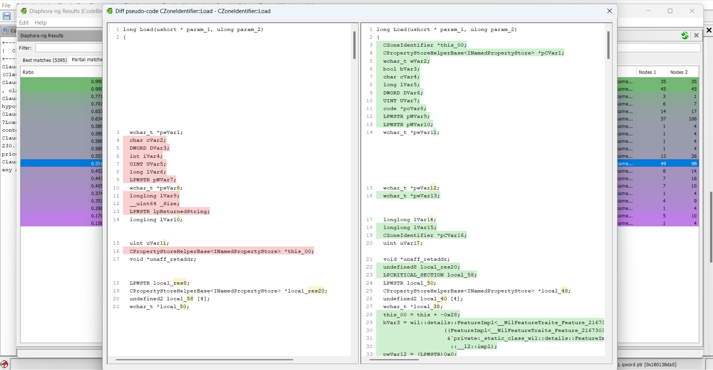
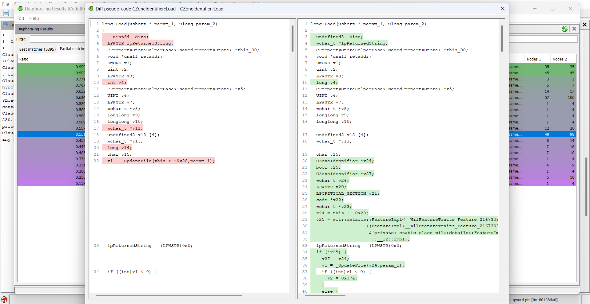

# Diaphora-ng for Ghidra

[Diaphora](https://github.com/joxeankoret/diaphora), the program diffing tool by Joxean Koret, ported to Ghidra 12.2+ as a native Java extension, **plus Claude diff pseudo-code**: [Claude-Rays Decompiler for Ghidra](https://github.com/Claude-Rays/claude-rays-decompiler-ghidra) decompiles both versions of a match in a single query, aligned so that only the real changes stand out, lists the changes and assesses whether the patch fixes a security bug.

Everything else is [diaphora-ghidra](https://github.com/Claude-Rays/diaphora-ghidra), including its canonical local names for the pseudo-code diffs: the port is based on Diaphora 3.4.1, commit [`de0eb92`](https://github.com/joxeankoret/diaphora/tree/de0eb920c1e54649bb3e7c4df5fa058b5c2cdc91) of the original repository, and its SQLite database schema (version 3.4) and SQL heuristics are those of the Python version.

Exporting and diffing two builds of urlmon.dll (September vs October 2026), then *Diff pseudo-code* and *Claude diff pseudo-code* on a patched function, `CZoneIdentifier::Load`:



> **Note:** So far the extension has only been tested on Windows, with Ghidra 12.1.4 and 12.2, and x64 PE binaries.

Diaphora-ng and diaphora-ghidra can be installed side by side: Diaphora-ng has its own package (`org.diaphorang.ghidra`), plugin (`DiaphoraNgPlugin`), menu (**Diaphora-ng**), results window and preferences.

## Features

- **Everything of diaphora-ghidra:** export to SQLite (v3.4) with control flow graphs, MD-Index, Ghidra's pseudo-code and its hashes; the **50 SQL heuristics** of Diaphora and its matching logic; the results window with the commands of the original; import of names, prototypes, comments and types; `.diaphora` results files.
- **Canonical local names** in the pseudo-code diffs (levels 1 and 2, optional, as in diaphora-ghidra): the same variable gets the same name on both sides, so the diff of two builds shows the real changes instead of renamed registers.
- **Claude diff pseudo-code** (new): both versions decompiled by Claude in one query, aligned, with the changes and a security assessment.
- **"Related compilation unit" heuristic** without the hours-long queries of the original on binaries without symbols (see [Differences from the original](#differences-from-the-original)).

## Requirements

- Ghidra 12.2+ and the JDK it runs on (25+).
- For *Claude diff pseudo-code*: [Claude-Rays Decompiler for Ghidra](https://github.com/Claude-Rays/claude-rays-decompiler-ghidra) installed in the same Ghidra, with the [Claude Code](https://claude.com/claude-code) CLI installed and logged in. It is optional: Diaphora-ng finds its service at run time by name, adds its plugin to the tool if it is installed but not enabled, and without it the Claude commands say what is missing.

## Build & install

The Gradle wrapper (`gradlew.bat`, Gradle 9.1.0) downloads Gradle, so there is nothing else to install.

```bat
set GHIDRA_INSTALL_DIR=C:\path\to\ghidra_12.2_PUBLIC
gradlew.bat buildExtension
```

The extension zip lands in `dist\` (`ghidra_12.2_PUBLIC_<date>_diaphora-ng-ghidra.zip`). It includes [sqlite-jdbc](https://github.com/xerial/sqlite-jdbc), which Gradle downloads from Maven Central.

To install it:

1. In Ghidra's project window, open **File > Install Extensions...**, click **+** and select the zip. For the Claude commands, install the Claude-Rays Decompiler zip the same way.
2. Restart Ghidra.
3. Open a binary in the CodeBrowser. If Ghidra asks to configure the new plugins, enable **DiaphoraNgPlugin** (or enable it later in **File > Configure**).

## Usage

Everything is under the top-level **Diaphora-ng** menu of the CodeBrowser:

| Entry | What it does |
|---|---|
| Diff or export | Export dialog. Exports the program to SQLite and, if a second database is selected, diffs them |
| Show results (F3) | Reopens the results window |
| Load results / Save results | `.diaphora` files. Load asks for the databases if they were moved |
| Load and import results | Loads a `.diaphora` file and imports every `sub_*` best and partial match with a ratio >= 0.5 (`DIAPHORA_MINIMUM_IMPORT_RATIO`) |
| Import definitions | Imports the structures, unions and enumerations of a database |
| Local diff | Diffs the function under the cursor against another function of the same program (`extras/diaphora_local.py`) |
| Pseudo-code diff settings | Level 2 of the pseudo-code diffs (see [Differences from the original](#differences-from-the-original)) |

Typical workflow: export binary A to `A.sqlite`, open binary B, and in *Diff or export* pick `B.sqlite` as output and `A.sqlite` as the database to diff against.

Right-click on the *Best*, *Partial*, *Unreliable* and *Problematic* tabs for the commands of the original:

| Command | What it does |
|---|---|
| Diff again | Opens the diff dialog again with the same databases |
| Save results | Same as the main menu |
| Add manual match | Pick a function of each database; the match goes to *Partial* with the ratio Diaphora calculates |
| Diff assembly / Diff pseudo-code | Side by side diff (the primary pseudo-code is decompiled again) |
| Diff assembly in a graph | Both basic block graphs side by side: modified blocks in yellow, new blocks in red. Drag to move, wheel to zoom, double click to fit |
| Diff using an external tool | Runs a command line with `$1` and `$2` replaced by the two files |
| Show assembly patch / Show pseudo-code patch | Unified diff |
| Show callers and callees graph | Call graph context of both functions |
| **Claude diff pseudo-code / Claude pseudo-code patch** | Diaphora-ng: both versions decompiled by Claude in one query, side by side or as a patch (see below) |
| **Regenerate Claude diff** | Diaphora-ng: asks Claude again instead of using the cache |
| **Set the new version for Claude...** | Diaphora-ng: asks again whether the open program is the new version |
| Import selected / Import selected sub_\* | Imports the selected matches (with one item, it also asks to import the definitions) |
| Import \*all\* functions / Import \*all\* data for sub_\* functions | Imports every match of the tab, or only those still named `sub_*` |
| Highlight / Unhighlight matches | Colors the matched functions in the listing |
| Delete match (or `Del`) | Removes the match |
| Go to primary address / Highlight basic block differences / Clear basic block colors | Extras of this port |

The *Unmatched* tabs only offer *Show assembly* and *Show pseudo-code*.

### Claude diff pseudo-code



- **Orientation:** Diaphora does not know which version is the patched one. The first Claude command on a set of results asks whether the open program is the **new** version; the answer is kept until other results are loaded (*Set the new version for Claude...* asks again).
- **What is sent:** version A is the open program: Claude-Rays Decompiler reads its full context from Ghidra, so the program of the primary database must be open in the tool. Version B is sent from the secondary database: function, basic blocks, instructions and their comments, callees, constants, and the diff of the cleaned assembly, which tells the model what really changed.
- **The view:** above the code, the model, effort, date, tokens and cost; the **assessment** (a hypothesis: class, reasoning, confidence, what to check next); the **changes** with their addresses in each version; the validator warnings, the uncertain spots and the summaries. Then OLD and NEW side by side (or as a patch). The source line numbers of the WIL diagnostics (`Return_Hr(_ReturnAddress(), 0x339, "file.cxx", hr)`) are ignored when comparing, since they move whenever the source file changes.
- **Cache:** Claude-Rays Decompiler caches the answer in the program; *Regenerate Claude diff* skips the cache.
- **Cost and privacy:** one query per pair, with the model and effort set in Claude-Rays Decompiler; on a subscription it counts against the plan's usage. The disassembly of both versions leaves your machine and goes to Anthropic through the Claude Code CLI.

A GhidraDec diff, as in [Diaphora-ng for IDA Free/Pro](https://github.com/Claude-Rays/diaphora-ng-idafree), is not needed in Ghidra: *Diff pseudo-code* already uses Ghidra's decompiler, with the canonical local names below.

To regenerate the heuristics from a checkout of the original: `python tools/gen_heuristics.py C:\path\to\diaphora` (by default it looks for `..\diaphora`, next to this repository).

## Differences from the original

- **Claude diff pseudo-code:** new, see above.
- **Canonical local names (optional)**, as in diaphora-ghidra. Ghidra names locals after registers and stack offsets (`uVar3`, `local_28`), so two builds of the same function get different names and the pseudo-code diff of two builds is mostly noise. Two optional phases, both on by default; with both off, the diffs are those of the original Diaphora on Ghidra's output, and matching and the heuristics are unchanged.
  - **Level 1, canonical names** (`export/LocalNames`): the locals are named `v1`, `v2`... in the order of first use, as Hex-Rays does. It is applied when exporting, so it also changes the pseudo-code hashes. It is a checkbox of the export dialog, recorded in the database (`program_data`, `type = 'export_option'`, `name = 'canonical_local_names'`), and *Diff pseudo-code* decompiles the primary as the secondary was exported.
  - **Level 2, renaming after the other side** (`util/LocalRenamer`, the same algorithm as GhidraDec's diff): *Diff pseudo-code*, *Show pseudo-code patch* and *Local diff* rename the locals of the secondary side after the primary, matched by where they are used. Only the views change. It is set in *Diaphora-ng > Pseudo-code diff settings*.

  Both are stored in the Ghidra preferences `diaphora-ng.canonicalLocalNames` and `diaphora-ng.renameLocals`.

  *Diff pseudo-code* of `CZoneIdentifier::Load` with both levels off: Ghidra's names differ on each side (`cVar2` / `cVar4`, `uVar11` / `uVar17`...), so most declarations are marked as changed:

  

  With both levels on: the locals are `v1`, `v2`... and have the same names on both sides, so only the new locals and the new code (the WIL feature flag and the critical section) are marked:

  
- **"Related compilation unit" heuristic** (`DiaphoraDiffer.findRelatedCompilationUnit`). The original compares every function inside the address range of the matched function's compilation unit. Compilation units found by LFA interleave, so those ranges cover a large part of the binary: in urlmon.dll they cover about 9 times as many functions as the units contain, and without symbols the heuristic took hours. Now it compares only the functions that **belong** to each unit (`compilation_unit_functions`), queries each pair of units once, and applies one timeout to the whole heuristic. The cost: functions close in address but in another unit, or in no unit, are no longer found by this heuristic (other heuristics may still find them). The Ghidra exporter does not fill `compilation_units`, so with databases exported by this extension the heuristic finds nothing, as in diaphora-ghidra.
- **No microcode.** Ghidra has no Hex-Rays microcode, so the microcode columns stay empty and the microcode commands are disabled.
- **No Python.** Project-specific Python scripts (hooks) and the scikit-learn machine learning model are not supported.
- **Import:** type libraries (TILs), IDA function flags and forced operand names don't exist in Ghidra and are not imported.
- **No batch modes or standalone diffing.** The `DIAPHORA_AUTO*` batch modes and `python diaphora.py db1 db2` were not ported; diffing runs from the Ghidra UI. The configuration of `diaphora_config.py` is compiled in; `DIAPHORA_MINIMUM_IMPORT_RATIO` can still be overridden with an environment variable.
- **MD-Index** is computed in `double`. Python uses `Decimal` with 28 digits, so the text in `md_index` can differ in the last digits from a database exported by the Python version.

## License

Like the original, this port is released under the GNU AGPL v3; see [LICENSE](LICENSE). The parts ported from third-party code keep their notices in the source headers: kfuzzy (LGPL 2.1), Python's difflib (PSF License) and Paul Harrison's Tarjan sort. The extension zip bundles sqlite-jdbc (Apache License 2.0) and its dependency slf4j-api (MIT).
